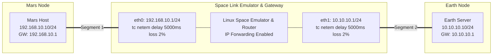

# Topology Specification — Project ARES: The Mars Colony Network

## 1. Architectural Overview

Project ARES models an interplanetary internetworking architecture connecting a localized Mars Habitat Local Area Network (LAN) to Earth Mission Control via an intermediary Deep Space Optical/RF Link. 

Because terrestrial routing protocols and TCP transport assumptions rely on short propagation delays, the architecture is partitioned into three distinct operational domains:
1. **Mars Colony LAN (Subnet: `192.168.10.0/24`)**: High-speed, low-latency local habitat network.
2. **Interplanetary Space Link (Subnets: `172.16.1.0/30` and `172.16.2.0/30`)**: Extremely high propagation delay, jitter, and stochastic bit error rates.
3. **Earth Mission Control LAN (Subnet: `10.10.10.0/24`)**: Terrestrial command center operations.

---

## 2. Primary 5-Node Topology (GNS3 / Cisco IOS or Linux VMs)

This is the standard academic topology representing full edge-router separation.

### 2.1 Mermaid Diagram

```mermaid
flowchart LR
    subgraph MARS_COLONY ["Mars Colony LAN (192.168.10.0/24)"]
        MH["Mars Host<br/>192.168.10.10/24"]
        MR_LAN["eth0 / Fa0/0<br/>192.168.10.1/24"]
    end

    subgraph MARS_EDGE ["Mars Edge Router"]
        MR["Mars Router"]
        MR_WAN["eth1 / Fa0/1<br/>172.16.1.1/30"]
    end

    subgraph SPACE_LINK ["Deep Space Link Emulator (NetEm)"]
        SE_M["eth0<br/>172.16.1.2/30"]
        SE["Linux Space Emulator<br/>tc netem delay 5000ms loss 2%"]
        SE_E["eth1<br/>172.16.2.1/30"]
    end

    subgraph EARTH_EDGE ["Earth Edge Router"]
        ER_WAN["eth0 / Fa0/1<br/>172.16.2.2/30"]
        ER["Earth Router"]
        ER_LAN["eth1 / Fa0/0<br/>10.10.10.1/24"]
    end

    subgraph EARTH_LAN ["Earth Mission Control LAN (10.10.10.0/24)"]
        ES["Earth Server<br/>10.10.10.10/24"]
    end

    MH --- MR_LAN
    MR_LAN --- MR
    MR --- MR_WAN
    MR_WAN == "Mars-Space Segment (172.16.1.0/30)" === SE_M
    SE_M --- SE
    SE --- SE_E
    SE_E == "Space-Earth Segment (172.16.2.0/30)" === ER_WAN
    ER_WAN --- ER
    ER --- ER_LAN
    ER_LAN --- ES
```


### 2.2 ASCII Diagram
```text
+------------------------------------------------------------------------------------------------------------------------+
|                                                  PROJECT ARES TOPOLOGY                                                 |
+------------------------------------------------------------------------------------------------------------------------+

  [ Mars Host ]
   IP: 192.168.10.10/24
   GW: 192.168.10.1
         |
         | (Mars LAN: 192.168.10.0/24 - Fast/Gigabit Ethernet)
         v
  [ Mars Router ]
   LAN Interface  (eth0 / Fa0/0): 192.168.10.1/24
   WAN Interface  (eth1 / Fa0/1): 172.16.1.1/30
   Default Route: 0.0.0.0/0 -> 172.16.1.2
         |
         | (Mars-Space Point-to-Point: 172.16.1.0/30)
         v
  [ Space Link Emulator (Linux VM / Container) ]
   Mars-Facing (eth0): 172.16.1.2/30  <--- tc netem delay 5000ms loss 2% limit 10000
   Earth-Facing(eth1): 172.16.2.1/30  <--- tc netem delay 5000ms loss 2% limit 10000
   Route to Mars LAN : 192.168.10.0/24 -> 172.16.1.1
   Route to Earth LAN: 10.10.10.0/24   -> 172.16.2.2
   IP Forwarding     : net.ipv4.ip_forward = 1
         |
         | (Space-Earth Point-to-Point: 172.16.2.0/30)
         v
  [ Earth Router ]
   WAN Interface  (eth0 / Fa0/1): 172.16.2.2/30
   LAN Interface  (eth1 / Fa0/0): 10.10.10.1/24
   Default Route: 0.0.0.0/0 -> 172.16.2.1
         |
         | (Earth LAN: 10.10.10.0/24 - Fast/Gigabit Ethernet)
         v
  [ Earth Server / Mission Control ]
   IP: 10.10.10.10/24
   GW: 10.10.10.1
```

---

## 3. Fallback 3-Node Topology (Pure Linux VMs or Containers)

For environments where hardware resources (RAM/CPU) cannot support 5 independent VMs or GNS3 router images, this 3-node architecture consolidates the edge-routing logic directly into the endpoints and emulator while preserving the exact subnet and IP schema.

### 3.1 Mermaid Diagram


---

## 4. Single-Machine Linux Network Namespaces (Zero VM Overhead)

Any student running a single Ubuntu laptop can execute the entire 5-node or 3-node simulation in isolated virtual network stacks (`ip netns`) using `veth` (virtual ethernet) pairs.

```bash
# Example instant 3-node namespace topology creation:
sudo ip netns add mars
sudo ip netns add space
sudo ip netns add earth

sudo ip link add veth-m type veth peer name veth-sm
sudo ip link add veth-se type veth peer name veth-e

sudo ip link set veth-m netns mars
sudo ip link set veth-sm netns space
sudo ip link set veth-se netns space
sudo ip link set veth-e netns earth

# Configure Mars Host
sudo ip netns exec mars ip addr add 192.168.10.10/24 dev veth-m
sudo ip netns exec mars ip link set veth-m up
sudo ip netns exec mars ip link set lo up
sudo ip netns exec mars ip route add default via 192.168.10.1

# Configure Space Emulator
sudo ip netns exec space ip addr add 192.168.10.1/24 dev veth-sm
sudo ip netns exec space ip addr add 10.10.10.1/24 dev veth-se
sudo ip netns exec space ip link set veth-sm up
sudo ip netns exec space ip link set veth-se up
sudo ip netns exec space ip link set lo up
sudo ip netns exec space sysctl -w net.ipv4.ip_forward=1

# Configure Earth Server
sudo ip netns exec earth ip addr add 10.10.10.10/24 dev veth-e
sudo ip netns exec earth ip link set veth-e up
sudo ip netns exec earth ip link set lo up
sudo ip netns exec earth ip route add default via 10.10.10.1
```

---

## 5. Segment Characteristics and Link Metrics

| Segment | Link Subnet | Technology | MTU | Propagation Delay | Loss Rate |
|---|---|---|---|---|---|
| Mars LAN | `192.168.10.0/24` | 1000BASE-T Ethernet | 1500 bytes | $< 1\text{ ms}$ | 0.0% |
| Mars-Space Link | `172.16.1.0/30` | Point-to-Point WAN | 1500 bytes | 2,500 ms (One-way) | 1.0% |
| Space-Earth Link | `172.16.2.0/30` | Point-to-Point WAN | 1500 bytes | 2,500 ms (One-way) | 1.0% |
| **Combined Space Link** | — | **Emulated Interplanetary Link** | — | **5,000 ms (Total One-Way)** | **2.0% (Total)** |
| Earth LAN | `10.10.10.0/24` | 1000BASE-T Ethernet | 1500 bytes | $< 1\text{ ms}$ | 0.0% |

---

## 6. Device Role and Command Execution Matrix

| Node Name | Physical / Virtual Platform | Primary Responsibility | Execution Label |
|---|---|---|---|
| **Mars Host** | Ubuntu VM / Container / Namespace | Traffic generation (iPerf3 client), ICMP probing, Wireshark/tcpdump capture | `[Mars Host]` |
| **Mars Router** | Cisco IOS Router (c7200) or Linux VM | Mars LAN default gateway, static route forwarder to Space Link | `[Mars Router]` |
| **Space Emulator** | Linux VM / Container (Ubuntu/Debian) | Kernel IP forwarding, `tc netem` latency, loss, and jitter injection | `[Space Emulator]` |
| **Earth Router** | Cisco IOS Router (c7200) or Linux VM | Earth LAN default gateway, static route forwarder to Space Link | `[Earth Router]` |
| **Earth Server** | Ubuntu VM / Container / Namespace | Traffic termination (iPerf3 server), Mission Control telemetry collector | `[Earth Server]` |
