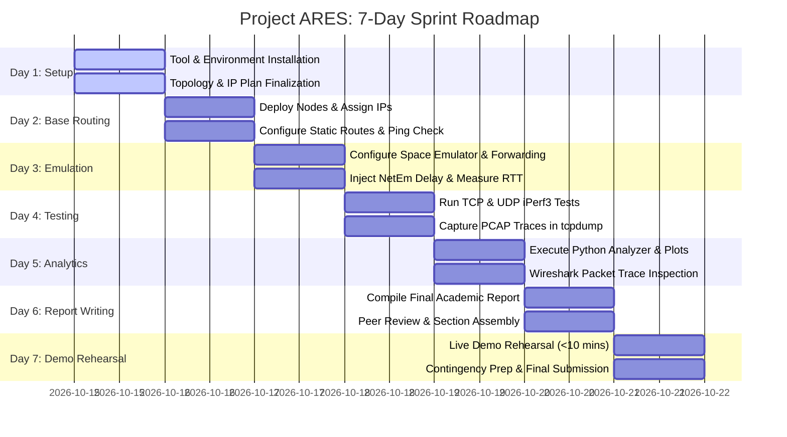

# NEXT_STEPS.md — 7-Day Team Execution Roadmap

This document outlines the exact, step-by-step chronological workflow for the 3 team members over the 7-day sprint. Every task defines prerequisites, responsible roles, execution commands, and expected deliverables to guarantee project completion on time.

---

## Team Roles & Ownership Matrix

| Team Member | Official Role | Primary Focus | Primary Artifacts & Tools |
|---|---|---|---|
| **Member 1** | **Network Architect** | Network topology, IP addressing, static routing, baseline connectivity | `topology.md`, `ip_addressing_table.md`, `mars_router_config.md`, `earth_router_config.md` |
| **Member 2** | **Space Link Engineer** | Emulation kernel, NetEm latency/loss profiles, jitter tuning, removal scripts | `space_emulator_config.md`, `space_link_netem.sh`, `remove_netem.sh` |
| **Member 3** | **Analyst and Tester** | iPerf3 client/server testing, packet capture, Python analytics, graph generation, report draft | `iperf_test_server.sh`, `iperf_test_client.sh`, `capture_traffic.sh`, `analyze_iperf.py`, `results_table_template.csv` |

---

## 7-Day Execution Timeline



---

## Day 1: Environment Setup & Architecture Confirmation
**Objective**: Guarantee that all software packages are installed and the simulation environment is ready.

1. **Morning (All Members Synchronous)**:
   - Decide deployment platform:
     - *Option A*: GNS3 with Cisco IOS c7200 / Linux VMs.
     - *Option B (Recommended)*: Pure Linux VMs on VirtualBox/VMware.
     - *Option C (Fastest Fallback)*: Single Ubuntu laptop using `build/setup_namespaces.sh`.
   - Install required packages:
     ```bash
     sudo apt update && sudo apt install -y iproute2 net-tools tcpdump iperf3 python3 python3-pip wireshark jq
     pip3 install matplotlib
     ```
2. **Afternoon (Role Breakdown)**:
   - **Member 1**: Review [topology.md](file:///c:/Users/shrey/Downloads/DCN_CP/build/topology.md) and [ip_addressing_table.md](file:///c:/Users/shrey/Downloads/DCN_CP/build/ip_addressing_table.md). Prepare virtual network adapters.
   - **Member 2**: Prepare the Space Emulator VM. Confirm `tc` and `netem` modules are active (`modprobe sch_netem`).
   - **Member 3**: Review [TEST_MATRIX.md](file:///c:/Users/shrey/Downloads/DCN_CP/TEST_MATRIX.md) and verify Python environment by running `python3 build/analyze_iperf.py` to inspect sample output.
3. **Day 1 Milestone / Done Criteria**:
   - [x] All 3 or 5 machines/nodes can boot and have IP addresses assigned on loopback.

---

## Day 2: Basic Network Build & Zero-Delay Connectivity
**Objective**: Achieve baseline end-to-end IP reachability from Mars Host to Earth Server.

1. **Step 2.1 — Member 1 (Network Architect)**:
   - Configure **Mars Router** and **Earth Router** following [mars_router_config.md](file:///c:/Users/shrey/Downloads/DCN_CP/build/mars_router_config.md) and [earth_router_config.md](file:///c:/Users/shrey/Downloads/DCN_CP/build/earth_router_config.md).
   - Assign `192.168.10.1/24` to Mars LAN and `172.16.1.1/30` to Mars-Space WAN.
   - Assign `10.10.10.1/24` to Earth LAN and `172.16.2.2/30` to Space-Earth WAN.
   - Configure Mars Host (`192.168.10.10/24`, GW: `192.168.10.1`) and Earth Server (`10.10.10.10/24`, GW: `10.10.10.1`).
2. **Step 2.2 — Member 2 (Space Link Engineer)**:
   - Configure **Space Emulator** following [space_emulator_config.md](file:///c:/Users/shrey/Downloads/DCN_CP/build/space_emulator_config.md).
   - Enable IP forwarding: `sudo sysctl -w net.ipv4.ip_forward=1`.
   - Add static routes to Mars LAN (`192.168.10.0/24 via 172.16.1.1`) and Earth LAN (`10.10.10.0/24 via 172.16.2.2`).
3. **Step 2.3 — Member 3 (Analyst & Tester)**:
   - Execute baseline verification from `[Mars Host]`:
     ```bash
     ping -c 5 10.10.10.10
     ```
   - Save terminal output as `results/ping_baseline.log` and take a screenshot (`screenshot_test00_baseline.png`).
4. **Day 2 Milestone / Done Criteria**:
   - [x] End-to-end ping succeeds with **0% packet loss** and **RTT $< 10\text{ ms}$**.

---

## Day 3: Space Link Emulation & Scaled Delay Calibration
**Objective**: Activate artificial space delay and stochastic packet loss using Linux `tc netem`.

1. **Step 3.1 — Member 2 (Space Link Engineer)**:
   - Deploy [space_link_netem.sh](file:///c:/Users/shrey/Downloads/DCN_CP/build/space_link_netem.sh) and [remove_netem.sh](file:///c:/Users/shrey/Downloads/DCN_CP/build/remove_netem.sh) to `[Space Emulator]`.
   - Make executable: `chmod +x space_link_netem.sh remove_netem.sh`.
   - Apply Profile A (Safe Demo Profile):
     ```bash
     sudo ./space_link_netem.sh profile_a
     ```
2. **Step 3.2 — Member 1 & Member 3**:
   - Verify delayed echo from `[Mars Host]`:
     ```bash
     ping -c 5 10.10.10.10
     ```
   - Confirm that Round-Trip Time jumps from $< 10\text{ ms}$ to **~10,000 ms (10.0 seconds)**.
   - Test delay removal on `[Space Emulator]`: `sudo ./remove_netem.sh`, verify RTT collapses back to $< 10\text{ ms}$, then re-apply `profile_a`.
   - Save log as `results/ping_delayed_5s.log` and take screenshot (`screenshot_test01_delay.png`).
3. **Day 3 Milestone / Done Criteria**:
   - [x] Delay injection and removal work cleanly on command; ping RTT visibly tracks the configured profile.

---

## Day 4: Full Protocol Testing & Packet Trace Capture
**Objective**: Generate experimental evidence for TCP vs. UDP behavior under interplanetary delay.

1. **Step 4.1 — Member 1 (Network Architect)**:
   - Log into `[Earth Server]` and launch the iPerf3 listening daemon:
     ```bash
     chmod +x iperf_test_server.sh
     ./iperf_test_server.sh start
     ```
   - Confirm status: `./iperf_test_server.sh status`.
2. **Step 4.2 — Member 2 (Space Link Engineer)**:
   - Start background packet capture on `[Space Emulator]` or `[Mars Host]`:
     ```bash
     chmod +x capture_traffic.sh
     sudo ./capture_traffic.sh 120 eth0
     ```
3. **Step 4.3 — Member 3 (Analyst & Tester)**:
   - On `[Mars Host]`, launch the comprehensive test suite:
     ```bash
     chmod +x iperf_test_client.sh
     ./iperf_test_client.sh tcp 60
     sleep 5
     ./iperf_test_client.sh udp 60
     ```
   - Verify generated JSON files in `results/` (`tcp_test_*.json`, `udp_test_*.json`).
   - Repeat for **Profile B (Extreme 15s delay / 5% loss)** to gather comparative contrast data.
4. **Day 4 Milestone / Done Criteria**:
   - [x] Both TCP and UDP JSON logs are safely stored; PCAP capture file is generated and transferred to analysis machine.

---

## Day 5: Data Analytics, Graphing & Packet Inspection
**Objective**: Process raw telemetry data into presentation-ready graphs and tables.

1. **Step 5.1 — Member 3 (Analyst & Tester)**:
   - Run the Python analytics script on the test results:
     ```bash
     python3 build/analyze_iperf.py
     ```
   - Confirm output files:
     - `tcp_vs_udp_throughput.png`
     - `results/parsed_iperf_summary.csv`
     - `results/parsed_iperf_intervals.csv`
2. **Step 5.2 — Member 2 (Space Link Engineer)**:
   - Open the `.pcap` capture file in Wireshark.
   - Filter by `tcp.analysis.retransmission` and take a high-resolution screenshot highlighting retransmission intervals.
   - Filter by `tcp.analysis.ack_rtt > 1.0` and capture the delayed acknowledgment delta.
3. **Step 5.3 — Member 1 (Network Architect)**:
   - Populate [results_table_template.csv](file:///c:/Users/shrey/Downloads/DCN_CP/build/results_table_template.csv) with the actual tested numbers.
4. **Day 5 Milestone / Done Criteria**:
   - [x] Publication-grade PNG graphs created, CSV tables completed, and Wireshark screenshots annotated.

---

## Day 6: Final Academic Report Assembly
**Objective**: Write and format the final project report in accordance with [REPORT_TEMPLATE.md](file:///c:/Users/shrey/Downloads/DCN_CP/REPORT_TEMPLATE.md).

1. **Section Ownership Breakdown**:
   - **Member 1**:
     - Section 1 (Title Page & Metadata)
     - Section 4 (Objectives)
     - Section 5 (Network Design, Topology & IP Addressing Plan)
     - Section 6 (Implementation Details & Router Configurations)
   - **Member 2**:
     - Section 2 (Abstract)
     - Section 3 (Introduction to Space Communication & Deep Space Challenges)
     - Section 6.4 (Space Link Emulation Methodology & NetEm Sizing)
     - Section 9 (Bandwidth-Delay Product Mathematical Derivation)
     - Section 12 & 13 (Future Scope & Academic References)
   - **Member 3**:
     - Section 7 (Testing Methodology)
     - Section 8 (Results, Comparative Graphs & Wireshark Evidence)
     - Section 10 (Discussion: TCP Window Collapse vs. UDP Telemetry Resilience)
     - Section 11 (Conclusion)
2. **Evening Synthesis**:
   - Merge all sections into a single document (`Project_ARES_Final_Report.pdf`).
   - Verify every chart has a caption, every table has clear headers, and all equations (BDP, RTT) are clearly derived.
3. **Day 6 Milestone / Done Criteria**:
   - [x] Complete, polished report draft ready for submission.

---

## Day 7: Live Demonstration Rehearsal & Final Package
**Objective**: Rehearse the live oral demo to ensure smooth delivery under 10 minutes, with ready backups.

1. **Step 7.1 — All Members**:
   - Rehearse the demo using [demo_script.md](file:///c:/Users/shrey/Downloads/DCN_CP/build/demo_script.md).
   - Time each speaker with a stopwatch:
     - Member 1 (0:00 – 3:00): Intro, Topology, and Baseline Ping.
     - Member 2 (3:00 – 4:30): NetEm delay activation and verification.
     - Member 3 (4:30 – 8:30): iPerf3 live demonstration, Python plot display, and BDP explanation.
     - Member 1 (8:30 – 9:45): Conclusion & recommendations.
2. **Step 7.2 — Backup Preparation**:
   - Place backup screenshots and pre-computed graphs on a USB drive and shared cloud folder.
   - Verify that [setup_namespaces.sh](file:///c:/Users/shrey/Downloads/DCN_CP/build/setup_namespaces.sh) is functional on a secondary laptop in case the primary presentation laptop encounters hypervisor issues.
3. **Day 7 Milestone / Final Definition of Done**:
   - [x] Team can complete live presentation in **$< 10\text{ minutes}$**.
   - [x] Final report, code repository, and evidence package submitted.
